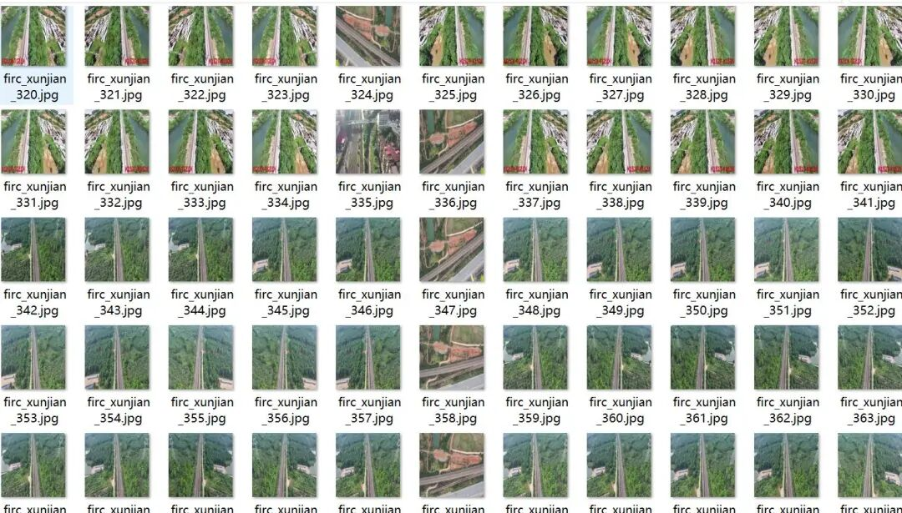
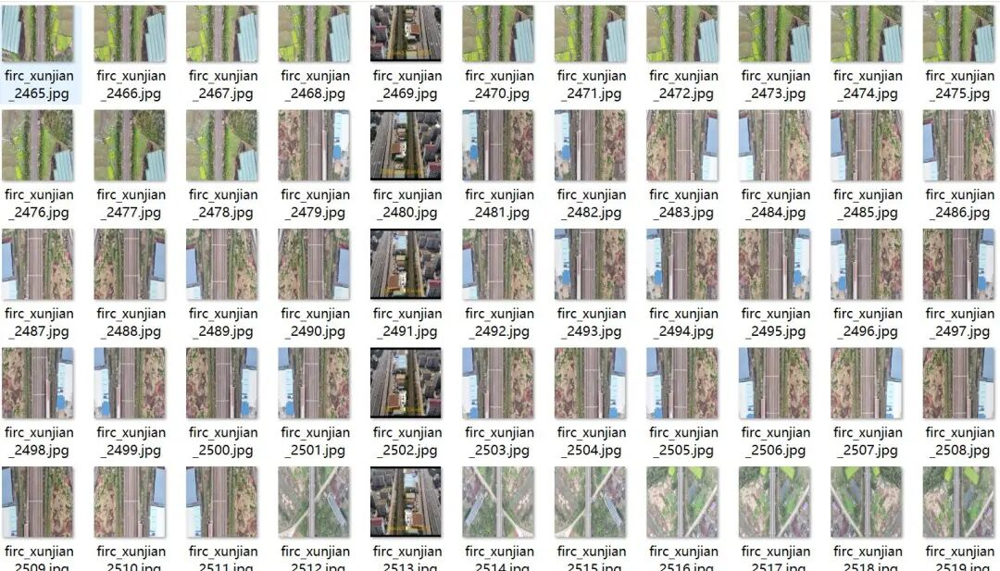
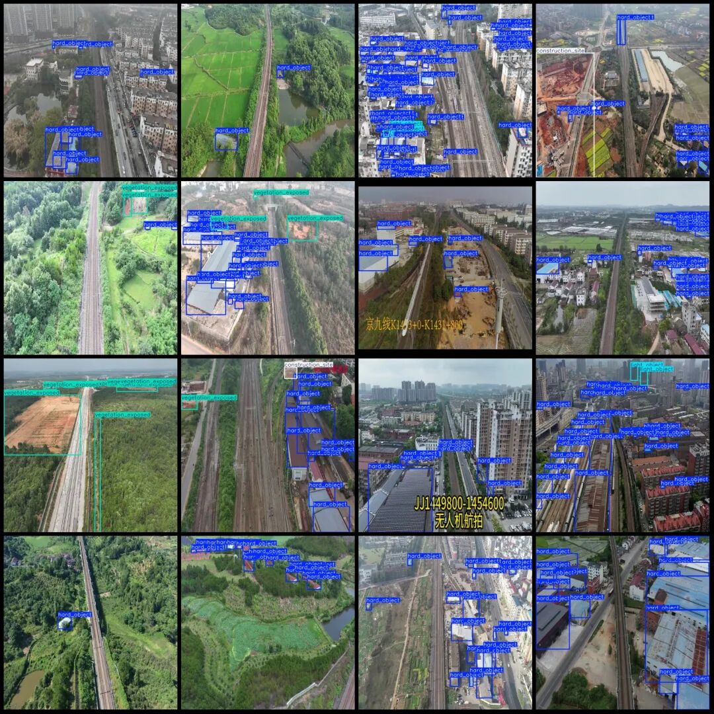

# UAV Perspective Urban Management Inspection Data Set for Illegal Rooftop Additions, Debris, and Vegetation Exposure Detection in VOC+YOLO format with 3434 images across 4 categories

The dataset contains enhanced images, approximately 1000 of which are originals, while the remaining are obtained by flipping and adjusting brightness contrast.

The dataset contains enhanced images, approximately 1000 of which are originals, while the remaining are obtained by flipping and adjusting brightness contrast.

Dataset format: Pascal VOC format + YOLO format (txt file without split path, only containing jpg images and corresponding VOC format xml files and yolo format txt files)

Number of images (number of jpg files): 3434

Number of annotations (number of xml files): 3434

Number of annotations (number of txt files): 3434

Labeling category count: 4

Label category names (note that the order of categories in the YOLO format does not correspond to this, but is based on the classes.txt file in the labels folder): ["constructionsite", "hardobject", "light_object", "vegetation_exposed"]

Hard_object-Illegal Construction

light_object-accumulated debris

vegetation_exposed-bare vegetation

Construction site

Number of boxes labeled in each category:

Construction_site Frames = 420

hard_object Frames = 39494

light_object Frames = 7063

vegetation_exposed Frames = 5171

Total frame count: 52148

Using labelImg:

Annotation rules: Draw a rectangle around the category.

Image resolution: 640x640

Important Notice: No

Special : This dataset does not guarantee the accuracy of the trained models or weight files.

Image Preview:

 Edit

 Edit

Annotation example:

 Editor

## Payment

Here is a pay link on Stripe ( https://buy.stripe.com/3cs8yP7sY87d0vu9AB ). Please contact me lonlonago@foxmail.com after funding $89, and I will send you a complete data files , thank you!

